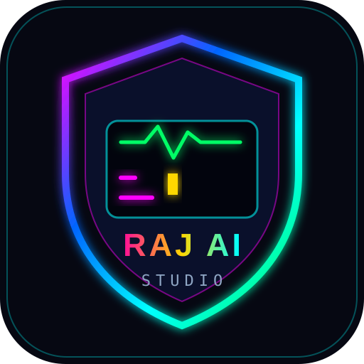
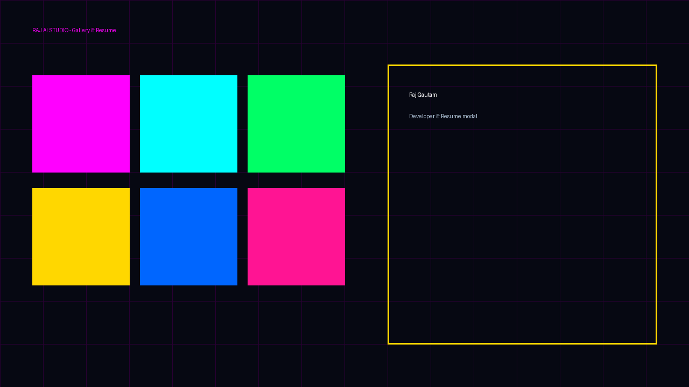
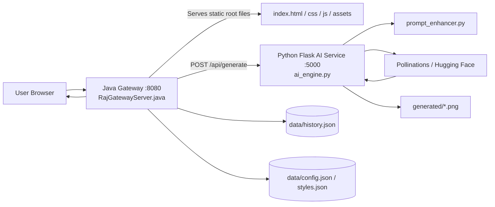
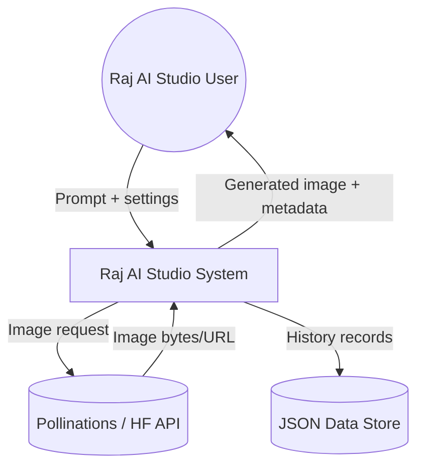
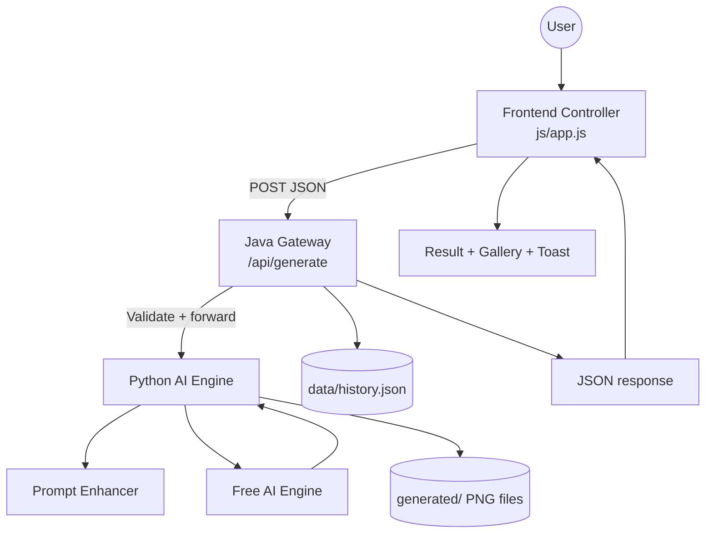

<div align="center">


<br/>

# Raj AI Studio

**Dual-Mode Full-Stack & Static-Deployable AI Image Generator**

*Engineered by Raj Gautam*

[](./LICENSE)
[](https://adoptium.net/)
[](https://python.org/)
[](./data/config.json)
[](#-mode-1--static-cloud-deployment-github-pages--vercel--netlify)
[](#-free-ai-engines)

<br/>



</div>

---

## Overview

**Raj AI Studio** is a complete, production-grade, open-source AI image generation platform combining a dynamic 7-color RGB cyberpunk UI, a pure-Java gateway, a Python AI microservice, and a lightweight JSON data layer.

The key innovation is **dual-mode deployment** from a single codebase:

- **Static Cloud Mode**: deploy the root folder to GitHub Pages/Vercel/Netlify and the app auto-switches to direct browser-based free AI generation.
- **Full-Stack Local Mode**: run `./start.sh` to activate the Java gateway + Python AI microservice + persistent JSON history.

---

## Screenshots

<div align="center">

| Main Studio UI | Gallery & Developer Modal |
|---|---|
|  |  |

</div>

> Screenshots are project mockups included for README presentation. Run the app locally or deploy it to see the live interactive UI.

---

## Features

- **Dual-mode auto-switch**: detects Java backend on `localhost:8080`; falls back to browser Pollinations API when unavailable.
- **Free unlimited generation**: Pollinations AI (`flux-realism`, `flux`, `any-dark`, `turbo`) with no API key required.
- **Optional Hugging Face token**: supports `black-forest-labs/FLUX.1-schnell` via free HF token.
- **Prompt realism enhancer**: auto-appends photorealistic detail suffix for higher-quality outputs.
- **7-color cyberpunk UI**: obsidian base with magenta, neon green, hot pink, electric yellow, crimson red, cyan, electric blue.
- **Dynamic feel**: animated particle/cyber-grid canvas, 3D tilt cards, magnetic button, live progress timer, toast notifications.
- **Style presets**: Photorealistic, Cyberpunk, Anime, 3D Render, Cinematic, Dark Hacker (loaded from `data/styles.json`).
- **History/gallery**: localStorage in static mode; `data/history.json` in full-stack mode.
- **Developer & Resume modal**: Raj Gautam profile, skills, education, social links, and print/download resume button.
- **Zero external Java JARs**: gateway uses built-in `com.sun.net.httpserver.HttpServer`.

---

## Architecture

### Mode 1: Static Cloud Deployment (GitHub Pages / Vercel / Netlify)


### Mode 2: Full-Stack Local Mode (Java + Python + JSON)



---

## SRS Summary (Software Requirements Specification)

### 1. Functional Requirements

| ID | Requirement | Mode |
|---|---|---|
| FR-1 | Serve `index.html` from repository root with relative assets | Both |
| FR-2 | Accept prompt, style, model, width, height and generate image | Both |
| FR-3 | Auto-detect backend health at `http://localhost:8080/api/health` | Both |
| FR-4 | Fall back to browser Pollinations generation when gateway unavailable | Static |
| FR-5 | Route generation through Java gateway to Python microservice | Full-stack |
| FR-6 | Enhance prompt with realism suffix and style preset suffix | Both |
| FR-7 | Persist generation metadata to `data/history.json` | Full-stack |
| FR-8 | Expose `/api/generate`, `/api/history`, `/api/styles`, `/api/health` | Full-stack |
| FR-9 | Display recent gallery and allow local clear | Both |
| FR-10 | Provide Developer & Resume modal with print/save capability | Both |

### 2. Non-Functional Requirements

| ID | Category | Requirement |
|---|---|---|
| NFR-1 | Usability | Responsive UI for desktop/mobile, clear error toasts, accessible labels |
| NFR-2 | Performance | Frontend loads without build step; generation progress timer visible |
| NFR-3 | Reliability | Static fallback prevents total failure when backend is offline |
| NFR-4 | Security | Java validates payloads, prevents path traversal, CORS headers scoped for API |
| NFR-5 | Portability | Root-relative paths; no external Java dependencies; Python deps in requirements.txt |
| NFR-6 | Maintainability | Modular layers: frontend, Java gateway, Python AI service, JSON data |

### 3. External Interfaces

- **User Interface**: `index.html`, `css/style.css`, `js/app.js`
- **Java API**: `http://localhost:8080/api/*`
- **Python API**: `http://127.0.0.1:5000/api/*`
- **Free AI APIs**: Pollinations image endpoint; optional Hugging Face Inference API

---

## DFD (Data Flow)

### Level 0 — Context Diagram



### Level 1 — Full-Stack Flow



---

## Directory Structure

```text
raj-ai-studio/
├── index.html                  # Root entry point (GitHub Pages ready)
├── css/
│   └── style.css               # 7-color RGB cyberpunk styling
├── js/
│   └── app.js                  # Dual-mode controller (auto-switch)
├── assets/
│   ├── logo.svg                # Neon cyber-shield logo
│   ├── banner.svg              # README/hero banner
│   ├── screenshot-main.png     # README screenshot
│   └── screenshot-gallery.png  # README screenshot
├── generated/
│   └── .gitkeep                # Generated PNG output directory
├── backend-java/
│   └── RajGatewayServer.java   # Pure Java HTTP gateway (port 8080)
├── ai-service-python/
│   ├── ai_engine.py            # Flask AI microservice (port 5000)
│   ├── prompt_enhancer.py      # Realism/style prompt injector
│   └── requirements.txt        # Python dependencies
├── data/
│   ├── config.json             # Ports/models/endpoints config
│   ├── styles.json             # UI style presets
│   ├── history.json            # Persistent generation history
│   └── analytics.json          # Reserved analytics store
├── start.sh                    # Linux one-command launcher
├── start.bat                   # Windows one-command launcher
├── .gitignore
├── LICENSE                     # MIT (Copyright 2026 Raj Gautam)
└── README.md
```

---

## Deployment & Run Guides

### 🌐 Mode 1 — Static Cloud Deployment (GitHub Pages / Vercel / Netlify)

This mode works with **no backend**. The app auto-switches to direct browser Pollinations generation.

#### GitHub Pages (1-click style)

1. Push this repository to GitHub.
2. Go to **Settings → Pages**.
3. Under **Build and deployment**, select:
   - **Source**: Deploy from a branch
   - **Branch**: `main` (or your default) / `/ (root)`
4. Save. Your site will be live at:
   `https://<username>.github.io/<repo>/`

#### Vercel / Netlify

- Import the repo.
- Framework preset: **Other / Static**.
- Build command: *(none)*
- Output directory: `.` (root)

> In static mode, generation history is stored in browser `localStorage`.

### 🖥 Mode 2 — Full-Stack Local Mode (Java + Python + JSON)

#### Prerequisites

- **JDK 17+** (`java`, `javac`)
- **Python 3.8+** (`python3`/`python`)
- Internet connection for free AI image generation

#### Linux / macOS

```bash
chmod +x start.sh
./start.sh
# Open: http://localhost:8080
```

#### Windows

```bat
start.bat
REM Open: http://localhost:8080
```

#### Manual run (debug)

```bash
# Terminal 1 — Python AI service
cd ai-service-python
python3 -m pip install -r requirements.txt
python3 ai_engine.py

# Terminal 2 — Java gateway
javac -d backend-java/out backend-java/RajGatewayServer.java
java -cp backend-java/out RajGatewayServer

# Open http://localhost:8080
```

---

## Quick Static Test (No Backend)

You can also open `index.html` directly in a browser for a quick UI check:

```bash
xdg-open index.html      # Linux
open index.html          # macOS
start index.html         # Windows
```

> Note: some browsers restrict `fetch()` for local `file://` JSON; style presets have built-in fallbacks, and image generation still works via direct Pollinations URL.

---

## Free AI Engines

| Engine | Type | Key Required | Default |
|---|---|---|---|
| Pollinations `flux-realism` | Free unlimited | No | ✅ |
| Pollinations `flux` | Free unlimited | No |  |
| Pollinations `any-dark` | Free unlimited | No |  |
| Pollinations `turbo` | Free unlimited | No |  |
| Hugging Face `FLUX.1-schnell` | Optional free token | Optional (`HF_API_KEY`) |  |

---

## API Reference (Full-Stack Mode)

| Method | Endpoint | Description |
|---|---|---|
| `GET` | `/api/health` | Gateway + Python status |
| `GET` | `/api/styles` | Style presets from `data/styles.json` |
| `GET` | `/api/history` | Recent generation history |
| `POST` | `/api/generate` | Generate image (validates, forwards to Python, logs history) |

### Example `POST /api/generate`

```json
{
  "prompt": "A neon cyberpunk city at night, rain reflections",
  "originalPrompt": "A neon cyberpunk city at night",
  "style": "cyberpunk",
  "width": 768,
  "height": 768,
  "seed": 482913,
  "model": "flux-realism"
}
```

---

## Developer Profile

<div align="center">

**Raj Gautam**  
BCA Student | Cybersecurity & Linux Enthusiast | Full-Stack & AI Tool Builder

Veer Bahadur Singh Purvanchal University, Jaunpur (2024–2027)

[](https://github.com/Rg100152)
[](https://instagram.com/linux.userraj)
[](https://youtube.com/@codeitraj)

</div>

---

## License

This project is licensed under the **MIT License**.  
Copyright © 2026 **Raj Gautam**. See [LICENSE](./LICENSE).
