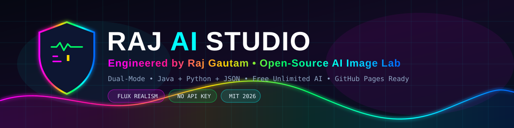
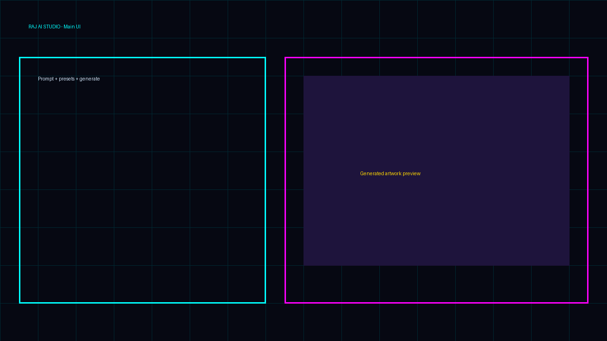

<div align="center">



<br/>


# Raj AI Studio

**Simple, Free, Dual-Mode AI Image Studio**

*Engineered by Raj Gautam*

[](https://rg100152.github.io/Raj-AI-Studio/)
[](./LICENSE)
[](https://adoptium.net/)
[](https://python.org/)
[](https://rg100152.github.io/Raj-AI-Studio/)

<br/>

<a href="https://rg100152.github.io/Raj-AI-Studio/"><strong>🚀 Open Live Website</strong></a>

</div>

---

## Live Demo

**Website:** [https://rg100152.github.io/Raj-AI-Studio/](https://rg100152.github.io/Raj-AI-Studio/)

The live site runs in **static/browser mode** — free image generation works with no API key.

---

## Screenshots

<div align="center">

| Studio Workspace | Gallery & Developer Profile |
|---|---|
|  |  |

</div>

---

## Overview

**Raj AI Studio** is an open-source AI image generation studio built by **Raj Gautam**. It has a clean, professional split-screen workspace and supports **dual-mode deployment**:

- **Static Mode (GitHub Pages/Vercel/Netlify):** works directly in browser using free Pollinations AI — no backend required.
- **Full-Stack Mode (Local):** runs Java gateway + Python AI microservice + JSON history for a complete local studio setup.

---

## Features

- **Simple & Free Generation** — Default Pollinations engine works with no API key.
- **Multiple Free Models** — `flux`, `flux-realism`, `turbo`, `zimage`, `any-dark`.
- **Optional Hugging Face** — Add free HF token only if you want HF models.
- **Pro Studio UI** — Split-screen layout: controls on left, preview canvas on right.
- **Prompt Enhancer** — One-click local realism enhancement for better image quality.
- **Aspect Ratios** — 1:1, 16:9, 9:16, 4:3 presets.
- **Style Presets** — Photorealistic, Cyberpunk, Anime, 3D Render, Cinematic, Dark Hacker.
- **Recent Gallery** — Local browser history; full-stack mode can use `data/history.json`.
- **Developer/Resume Modal** — Profile, skills, links, and print/save resume option.
- **Dual-Mode Auto Switch** — Automatically detects local backend; falls back to browser mode.

---

## Free AI Models

| Engine | Model | Key Required | Notes |
|---|---|---:|---|
| Pollinations | `flux` | No | Recommended, balanced quality |
| Pollinations | `flux-realism` | No | Realistic look |
| Pollinations | `turbo` | No | Fast generation |
| Pollinations | `zimage` | No | Free alternative model |
| Pollinations | `any-dark` | No | Dark/stylized output |
| Hugging Face | `FLUX.1-schnell` | Optional | Free token recommended |
| Hugging Face | `SDXL Base` | Optional | Can have cold starts |

---

## Quick Start

### 1) Use Online (Easiest)

Open the live site:

```text
https://rg100152.github.io/Raj-AI-Studio/
```

No install. No API key. Just enter a prompt and generate.

### 2) Run Full-Stack Locally

**Requirements:** JDK 17+, Python 3.8+

```bash
chmod +x start.sh
./start.sh
```

Then open:

```text
http://localhost:8080
```

**Windows:**

```bat
start.bat
```

### 3) Static Local Test

```bash
xdg-open index.html   # Linux
open index.html       # macOS
start index.html      # Windows
```

---

## Project Structure

```text
raj-ai-studio/
├── index.html                  # Main studio UI (root deployable)
├── css/style.css               # Pro obsidian/carbon styling
├── js/app.js                   # Dual-mode + generation logic
├── assets/
│   ├── logo.svg
│   ├── banner.svg
│   ├── screenshot-main.png
│   └── screenshot-gallery.png
├── backend-java/
│   └── RajGatewayServer.java   # Java gateway (port 8080)
├── ai-service-python/
│   ├── ai_engine.py            # Python AI microservice (port 5000)
│   ├── prompt_enhancer.py
│   └── requirements.txt
├── data/
│   ├── config.json
│   ├── styles.json
│   ├── history.json
│   └── analytics.json
├── start.sh
├── start.bat
├── LICENSE
└── README.md
```

---

## Tech Stack

- **Frontend:** HTML5, CSS3, Vanilla JavaScript
- **Backend Gateway:** Java (`com.sun.net.httpserver`)
- **AI Microservice:** Python Flask
- **Data:** JSON files
- **Free AI:** Pollinations (default), Hugging Face (optional)

---

## Developer

<div align="center">


**Raj Gautam**  
BCA Student | Cybersecurity & Linux Enthusiast | Full-Stack & AI Tool Builder

[](https://github.com/Rg100152)
[](https://instagram.com/linux.userraj)
[](https://youtube.com/@codeitraj)

</div>

---

## License

MIT License © 2026 **Raj Gautam**.  
See [LICENSE](./LICENSE) for details.
